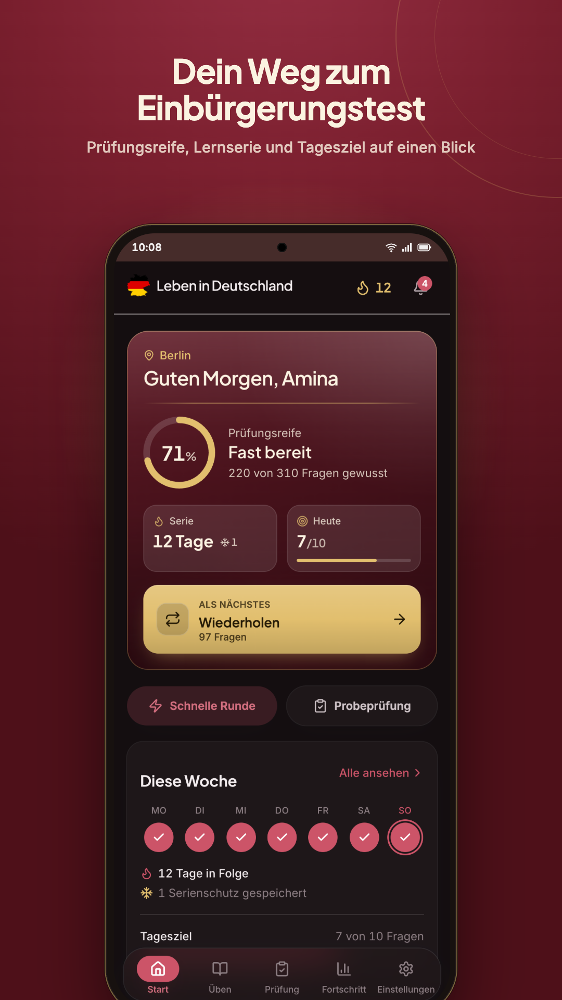
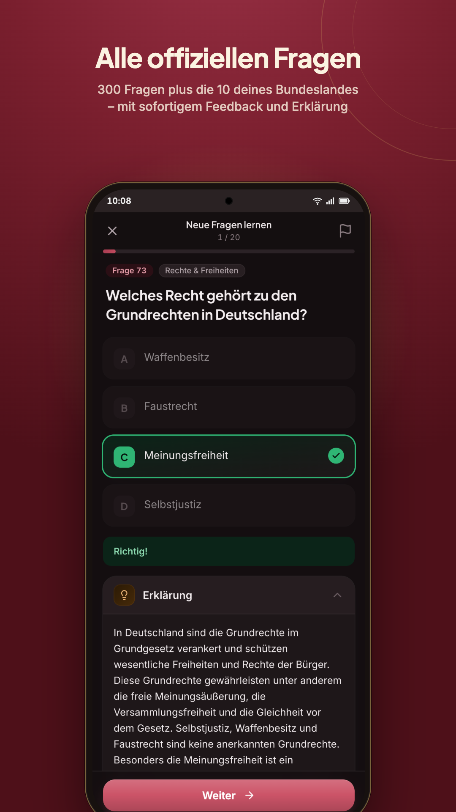
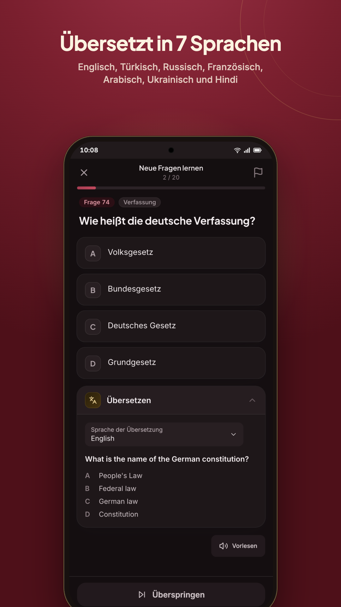
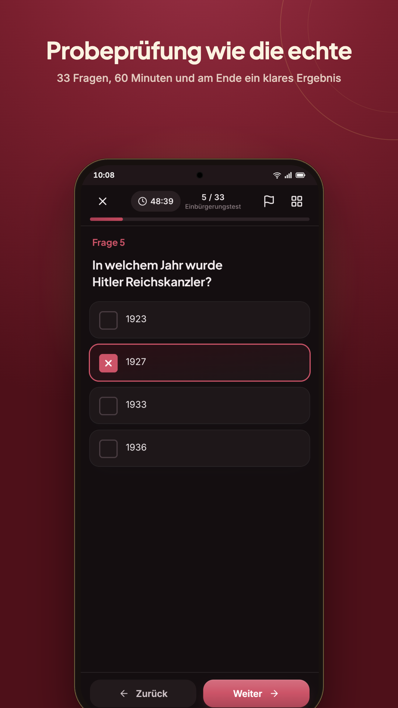
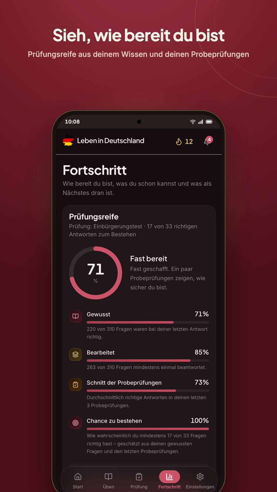
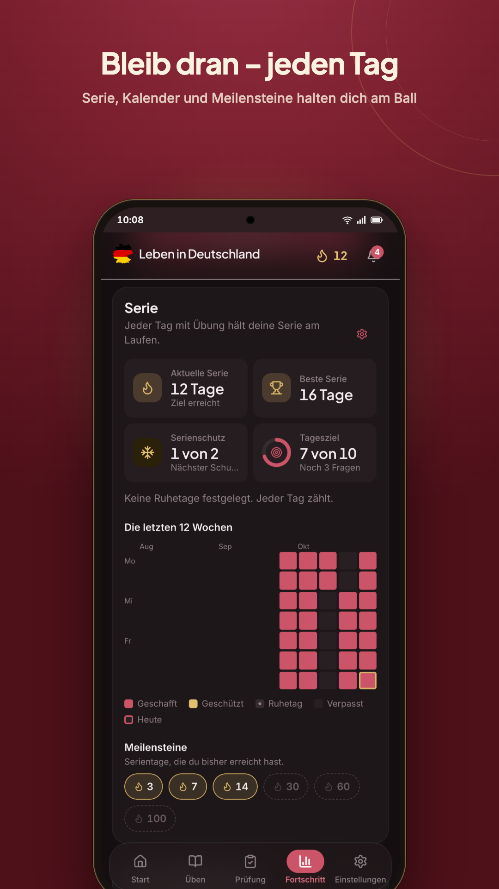
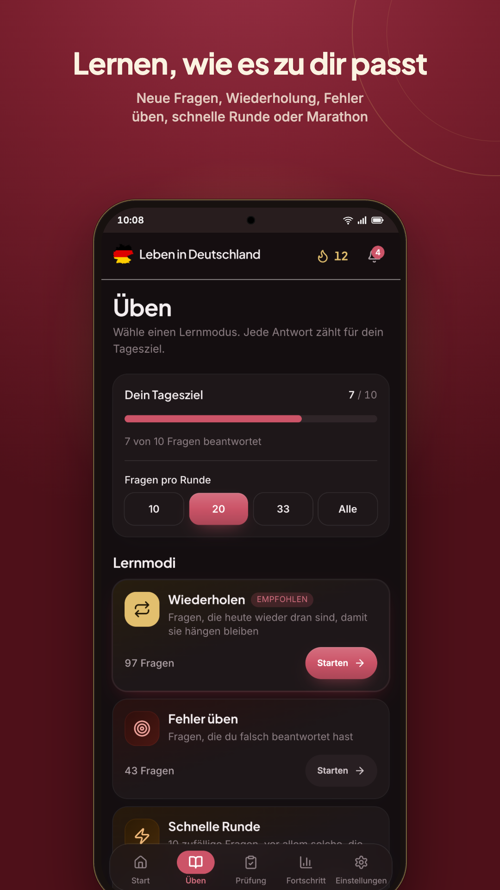
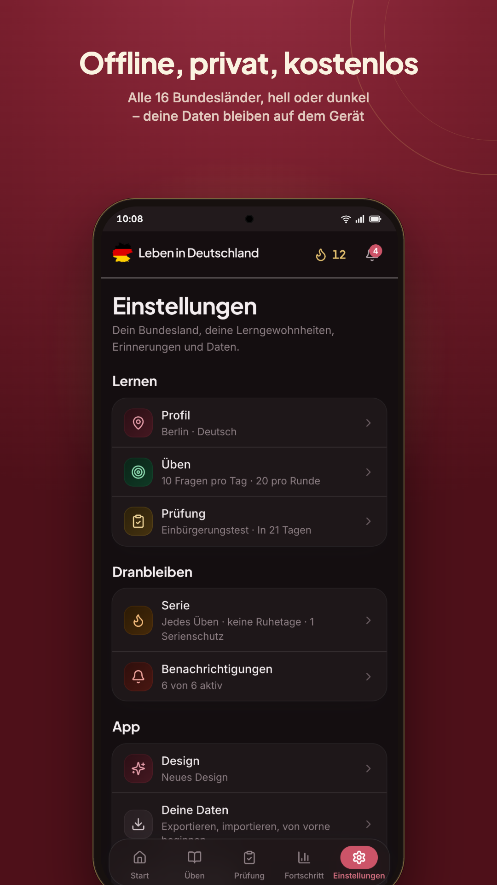

<p align="center">
  <a href="https://www.lebenindeutschland.org">
    
  </a>
</p>
<h1 align="center">Einbürgerungstest – Leben in Deutschland</h1>
<p align="center">
  Prepare for the German naturalisation test with every official question, a mock exam that feels like the real one, and a clear view of how ready you are.<br/>
  Web app, Android app and iPhone/iPad app from one code base – offline, private, free.
</p>
<p align="center">
  <a href="https://play.google.com/store/apps/details?id=org.lebenindeutschland.app">Google Play</a> ·
  <a href="https://apps.apple.com/de/app/id6829151281">App Store</a> ·
  <a href="https://www.lebenindeutschland.org">lebenindeutschland.org</a>
</p>

> This is a private study project, not an official app of the Federal Office for Migration and Refugees (BAMF). The test itself is taken at the BAMF only. Questions © BAMF.

## What the app does

- **All official questions** – the 300 general questions of the "Leben in Deutschland" / Einbürgerungstest catalogue plus the 10 questions of your federal state (all 16 states), with an explanation for every answer.
- **Translations and read-aloud** – questions in English, Turkish, Russian, French, Arabic, Ukrainian and Hindi; system voices read them out.
- **Mock exam like the real one** – 33 questions, 60 minutes, pass at 17 correct; results are kept so you can see your progress.
- **Exam readiness** – a readiness score from what you know and how your mock exams went, progress per topic, a countdown to your exam date.
- **Practice modes** – new questions, due reviews (spaced repetition), mistakes, flagged questions; quick rounds of 10 or longer sessions.
- **Stay on track** – streak with rest days and streak freezes, daily goal, weekly overview, optional reminders (apps), milestones.
- **Exam centres** – find a test centre near you.
- **Offline, private, free** – no account, no ads, no tracking; everything stays on the device. The apps offer optional tips that unlock nothing.

## Screenshots

<p>
  
  
  
  
</p>
<p>
  
  
  
  
</p>

## Repository layout

| Path | What it is |
| --- | --- |
| [`src/web`](src/web) | The app: Next.js (static export), React, HeroUI, Tailwind; tests with Vitest. Serves the website and is bundled into both native apps. |
| [`src/android`](src/android) | Capacitor Android project (Play Billing tips, notifications, status bar). |
| [`src/ios`](src/ios) | Capacitor iOS project (StoreKit 2 tips, notifications). |
| [`src/store`](src/store) | Store assets and publishing: screenshot pipeline, Google Play and App Store Connect scripts ([README](src/store/README.md)). |
| [`src/catalogue`](src/catalogue) | Tooling that keeps the question catalogue in sync with the official BAMF publication ([README](src/catalogue/README.md)). |
| [`.github/workflows`](.github/workflows) | Web deploy on merge; Android and iOS releases started by hand. |
| [`.pulse/automations`](.pulse/automations) | Standing data syncs (BAMF catalogue, evaluation status, exam centres) that the PULSE daemon runs; [`scripts`](scripts) holds their watch scripts. |
| [`.pulse/skills`](.pulse/skills) | Agent skills; [`AGENTS.md`](AGENTS.md) holds the repository rules. |

## Development

Prerequisites: Node.js 22. For the native apps additionally Android Studio with JDK 21, or Xcode 26 with CocoaPods.

```bash
cd src/web
npm install
npm run dev        # http://localhost:3000
npm test           # Vitest, the project's verification command
npm run lint
npm run build      # static export into src/web/out
```

Native apps (the web build is copied into the native projects by Capacitor):

```bash
cd src
make build-sync        # install, build, sync Android -> open src/android in Android Studio
make build-sync-ios    # install, build, sync iOS     -> open src/ios/App/App.xcworkspace in Xcode
```

The learner's data is a single record in `localStorage`; a dev build therefore starts with onboarding like a fresh install.

## Data

- **Questions** come from the official BAMF catalogue. A daily check looks for a new publication; when one appears, an agent compares it with the bundled catalogue, applies the safe part and hands the rest to a human review; the apps also refresh the catalogue over the air, at most once a day, from this repository.
- **Evaluation status and exam centres** are read from bamf.de by `scripts/bamf-data-sync.mjs`: a daily check (evaluation status and "last checked" date) and a weekly check (the exam centres of the 16 states) rewrite the bundled JSON files when the site changed; the Android app also refreshes the evaluation status over the air from this repository.

## Releases

- **Web** – every merge to `main` deploys to Vercel.
- **Android** – Actions → *Android Release* → *Run workflow*: signed bundle, GitHub release, upload to the Play Internal testing track; promotion to production is a click in the Play Console.
- **iOS** – Actions → *iOS Release* → *Run workflow*: TestFlight build; the version is submitted from App Store Connect.
- Store listings, products and screenshots are generated and published from [`src/store`](src/store/README.md).

## Privacy

No account, no analytics, no advertising SDKs. Learning data stays on the device; the apps download only public static files (catalogue, evaluation status, notices). Tips are handled by Google Play or Apple In-App Purchase. Full text: [privacy policy](https://www.lebenindeutschland.org/privacy-policy).

## Contributing

Issues and pull requests are welcome. Please read [`AGENTS.md`](AGENTS.md) first – it holds the rules every change follows (tests green, no secrets, store wording, release signing) – and keep `npm test` passing.

## Agents and Skills

Engineering records - decisions, plans, memory, workflows - live in the
[PULSE](https://github.com/manishtiwari25/pulse) store, not in this
repository. Project agent skills live under [`.pulse/skills/`](.pulse/skills/),
one folder per skill with a `SKILL.md`, and [`AGENTS.md`](AGENTS.md) holds the
repository rules.

## License

[MIT](LICENSE) for the code. The question catalogue is published by the Federal Office for Migration and Refugees (BAMF).
